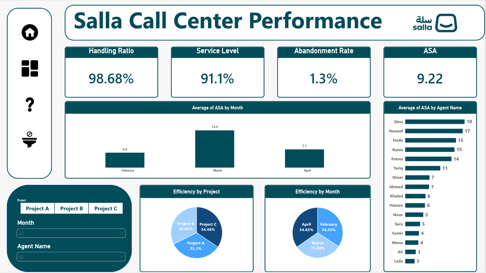

# Salla Call Center Dashboard

An interactive **Power BI** dashboard for monitoring call center performance across three projects and sixteen agents. It turns daily call data into service-level, abandonment, and answer-speed insights so team leads can quickly see where the operation is performing well and where it is falling short.

> **Author:** [Youssef](https://github.com/youssefamr4800)

---

## Table of Contents

- [Overview](#overview)
- [Dashboard Preview](#dashboard-preview)
- [Dashboard Features](#dashboard-features)
- [KPIs & DAX Measures](#kpis--dax-measures)
- [Dataset](#dataset)
- [Data Pipeline (Power Query)](#data-pipeline-power-query)
- [Key Insights](#key-insights)
- [Repository Structure](#repository-structure)
- [Tools & Technologies](#tools--technologies)
- [Getting Started](#getting-started)
- [Future Improvements](#future-improvements)
- [Contact](#contact)

---

## Overview

Call center managers need to know three things at a glance: **are we answering customers fast enough, are we answering them at all, and who or what is driving the gaps?** This report answers those questions using daily operational data from **1 Feb 2022 to 30 Apr 2022**, covering **1.74M calls offered** across **3 projects (A, B, C)** and **16 agents**.

## Dashboard Preview



## Dashboard Features

The report has a single, full-HD (1920 × 1080) **Overview** page with a custom navigation sidebar.

| Visual | Description |
|--------|-------------|
| **KPI cards** | Service Level, Handling Ratio, Abandonment Rate, and ASA at the top of the page |
| **ASA by Month (column chart)** | Average Speed of Answer per month, with a day-of-the-week breakdown |
| **ASA by Agent (bar chart)** | Compares answer speed across all agents |
| **Efficiency by Project (pie chart)** | Share of efficiency contributed by each project |
| **Efficiency by Month (pie chart)** | Share of efficiency contributed by each month |
| **Slicers** | Filter the whole page by **Month**, **Project**, and **Agent Name** |
| **Navigation buttons** | Sidebar with home, dashboard, help, and filter / unfilter bookmark buttons |

Branded with the Salla logo and a consistent teal (`#004B58`) color palette.

## KPIs & DAX Measures

All measures are defined on the `data` table:

| Measure | DAX | What it tells you |
|---------|-----|-------------------|
| **Service Level** | `SUM(data[Calls Handled With in Thrshold]) / SUM(data[Calls Offered])` | Share of offered calls answered within the target threshold |
| **Handling call ratio** | `SUM(data[Calls Handled]) / SUM(data[Calls Offered])` | Share of offered calls that were answered |
| **Abandonment Rate** | `SUM(data[Calls Abandon]) / SUM(data[Calls Offered])` | Share of offered calls where the customer hung up before being answered |
| **Efficiency** | `[Service Level] * [Handling call ratio]` | Combined indicator of both speed and coverage |

**ASA** (Average Speed of Answer) is calculated by averaging the `ASA` column.

## Dataset

A single fact table, `data`, with **267 rows**: one row per project per day (3 projects × 89 days). Each row is attributed to one agent.

| Column | Type | Description |
|--------|------|-------------|
| `Source.Name` | Text | Month taken from the source file name (Feb, Mar, Apr) |
| `Project` | Text | Project A, B, or C |
| `Date` | Date | Calendar date |
| `Forecasted Calls` | Integer | Forecasted call volume for the day |
| `Calls Offered` | Integer | Calls received |
| `Calls Handled` | Integer | Calls answered |
| `Calls Handled With in Thrshold` | Integer | Calls answered within the service-level threshold |
| `Calls Abandon` | Integer | Calls abandoned before being answered |
| `ASA` | Decimal | Average Speed of Answer for the day |
| `Answer Time` | Integer | Total answer time |
| `Agent Name` | Text | Agent attributed to the record |
| `Day name` | Text | Day of the week (added in Power Query) |

## Data Pipeline (Power Query)

The `data` table is loaded using the **Folder** connector, so new monthly files can be added to `data/` and picked up on refresh:

1. Read all files from the `data` folder and ignore hidden files
2. Apply a shared transform function to each file and expand the results into one table
3. Extract the month name from the file name into `Source.Name`
4. Remove the redundant `Month` column
5. Set data types (integers, dates, decimals)
6. Add a `Day name` column derived from `Date`

## Key Insights

Figures below are computed from the data in this report (Feb–Apr 2022).

**Overall**

- **1,744,885** calls offered and **1,721,842** handled, a handling ratio of **98.7%**
- Service Level of **91.1%**, Abandonment Rate of **1.32%**, and Efficiency of **89.9%**

**By project**

| Project | Calls Offered | Service Level | Abandonment Rate | Avg ASA |
|---------|--------------:|--------------:|-----------------:|--------:|
| Project A | 767,109 | 91.5% | 0.97% | 10.1 |
| Project B | 899,756 | 90.3% | 1.66% | 11.7 |
| Project C | 78,020 | 95.2% | 0.86% | 5.8 |

- **Project B** carries the most volume and has the **highest abandonment rate** and slowest answer speed
- **Project C** performs best on every metric, though at a much lower volume

**By month**

| Month | Calls Offered | Service Level | Abandonment Rate | Avg ASA |
|-------|--------------:|--------------:|-----------------:|--------:|
| Feb | 446,217 | 94.7% | 0.48% | 5.8 |
| Mar | 876,199 | 87.1% | 2.15% | 14.4 |
| Apr | 422,469 | 95.5% | 0.50% | 7.1 |

- **March call volume nearly doubled**, and service quality dropped sharply: abandonment was more than 4× February's rate
- The worst single day was **5 March 2022** (Project B), with an ASA of about 181

**By day of week**

- **Monday** is the strongest day (98.2% service level, 0.41% abandonment)
- **Saturday** is the weakest (85.3% service level, 2.38% abandonment), followed by **Thursday** (85.9%) and **Friday** (89.7%)

**By agent**

- Strongest service levels: **Laila (99.5%)**, **Sara (98.3%)**, **Mona (97.8%)**, **Ali (97.7%)**
- Lowest service levels: **Youssef (77.5%)**, **Dina (78.1%)**, **Huda (84.5%)**, **Rania (84.9%)**, who also have the longest answer times

**Takeaway:** Staffing should be weighted toward peak-volume periods (March, and the Thursday–Saturday window), and Project B and the lowest-scoring agents are the clearest candidates for coaching or additional support.

## Repository Structure

```
Salla_Call_Center_Dashboard/
├── data/          # Monthly source files (Feb, Mar, Apr 2022)
├── Salla.pbix     # Power BI report
└── README.md      # Project documentation
```

## Tools & Technologies

| Tool | Purpose |
|------|---------|
| **Power BI Desktop** | Report design and visualization |
| **Power Query (M)** | Folder-based ingestion, cleaning, and transformation |
| **DAX** | KPI measures |

## Getting Started

### Prerequisites

- [Power BI Desktop](https://powerbi.microsoft.com/desktop/) (free, Windows)

### Run the dashboard

1. Clone the repository:
   ```bash
   git clone https://github.com/youssefamr4800/Salla_Call_Center_Dashboard.git
   cd Salla_Call_Center_Dashboard
   ```
2. Open `Salla.pbix` in Power BI Desktop.
3. The report's data source points to the original author's local folder (`D:\DA\Salla Dashboard\data`). Update it to the cloned `data/` folder:
   **Home → Transform data → Data source settings → Change Source…**, or edit the `Source` step of the `data` query in Power Query.
4. Click **Refresh**, then explore the report using the slicers.

## Future Improvements

- Publish to Power BI Service with scheduled refresh
- Add hourly or interval-level data to pinpoint intraday peaks
- Add a drill-through page for individual agent performance
- Add target lines for Service Level and Abandonment Rate
- Extend the dataset beyond three months to enable trend forecasting

## Contact

**Youssef**
GitHub: [@youssefamr4800](https://github.com/youssefamr4800)

---

⭐ If you found this project useful, consider giving it a star!
